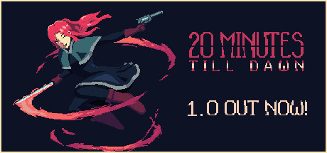

**20 Minutes Till Dawn is a dark fantasy survivor-like where you choose a character and weapon combo and fight off endless Lovecraftian hordes for 20 minutes using increasingly powerful rune upgrades. Features a fast, focused, highly replayable loop.**

---

## 📖 About

20 Minutes Till Dawn is a dark fantasy survivor-like where you choose a character and weapon combo and fight off endless Lovecraftian hordes for 20 minutes using increasingly powerful rune upgrades. Features a fast, focused, highly replayable loop.

## ⚠️ Problems Without Trainer

| Problem | Status |
|---------|--------|
| **Early Run Difficulty** — First runs with new characters feel extremely punishing before upgrades | ✅ Solved |
| **Build Synergy** — Some character and rune combinations are dramatically stronger than others | ✅ Solved |
| **Darkness Scaling** — Enemies grow overwhelming without specific damage-scaling builds | ✅ Solved |
| **Endless Mode** — Surviving past 20 minutes in endless requires near-perfect build optimization | ✅ Solved |

## ✅ Solution

The **20 Minutes Till Dawn Trainer** solves all these issues by giving you complete control over the game.

## 🎯 Full Feature List

- Unlimited Resources
- God Mode / Invincibility
- Instant Skill Cooldown
- One-Hit Kill
- Freeze Game Timer
- Unlock All Items & Achievements
- Custom Speed Multiplier
- Save State Anywhere

## 🚀 Quick Start

1. **Disable Windows Defender** temporarily (trainer may trigger false positive)
2. Download the trainer from the button above
3. Launch 20 Minutes Till Dawn
4. Run the trainer as Administrator
5. Activate desired cheats with hotkeys

## 💎 Free vs Paid

| Feature | Free | Pro |
|---------|------|-----|
| Basic God Mode | ✅ | ✅ |
| Unlimited Resources | ✅ | ✅ |
| All Advanced Cheats | ❌ | ✅ |
| Auto-Updates | ❌ | ✅ |
| Priority Support | ❌ | ✅ |

## 💻 Requirements

- Windows 10/11 (64-bit)
- 20 Minutes Till Dawn (any version)
- .NET Framework 4.8+
- DirectX 11+

## 🍎 macOS

macOS users can use our alternative tool:

## ⚖️ Legal

This trainer is for educational and single-player use only. Use responsibly.

---

